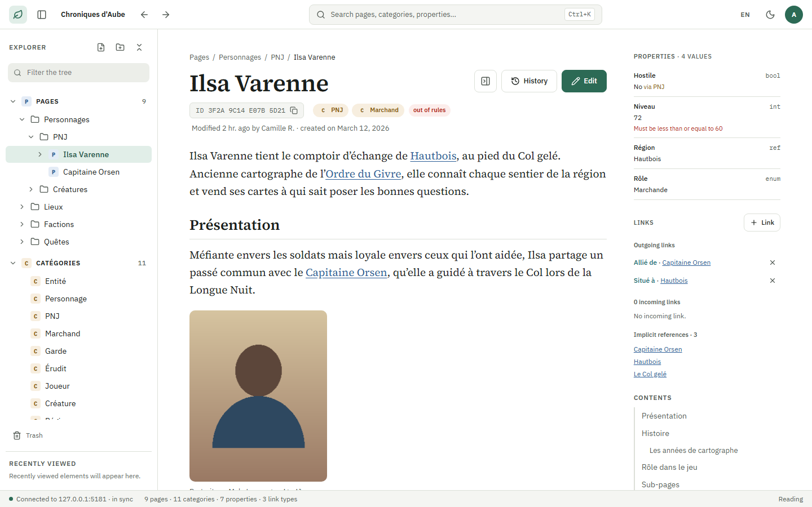

# Erable

[](https://github.com/LePtitDev/Erable/actions/workflows/pr.yml)
[](https://github.com/LePtitDev/Erable/releases/latest)
[](LICENSE)

A structured, IDE-style wiki: extended Markdown pages, categories with inheritance, typed and validated properties, typed links between elements, attachments.

> [!WARNING]
> **Warning**: This project is a personal project designed and developed with the help of Anthropic's Claude AI, and it is meant to remain experimental. My free time is limited, so I do not plan to actively maintain it. You are free to use it as you wish, knowing this.

Erable runs in two ways, from the same code:

- **local desktop application** (Windows, macOS, Linux): a project is a folder on your disk (SQLite + attachments), with no service to install;
- **multi-user server mode**, for working together (Docker or plain executable), usable from a browser, a phone or the Android application.



## Features

- **References go through the identifier** (`[[3F2A9C14E07B5D21]]`): renaming or moving an element never breaks anything. Typing `[[` in the editor opens a palette to pick the target by name.
- **Categories with inheritance** give pages **typed properties** (number, text, list, date, reference…) with rules; **validation warns, it does not block**.
- **Typed links** between pages ("mentor of" / "student of"), backlinks, attachments (images, video, PDF…) embedded with `![[ID]]`.
- **Full-text search** that ignores accents, with filters on categories and properties.
- **Nothing is lost by mistake**: trash, plus revisions that can be compared and restored.
- **Working together**: accounts and roles per project, live presence, concurrent saves merged on the server.
- **Backing up = copying a folder** (or continuous replication with Litestream on the server side).
- Interface in English, French, German and Spanish; light and dark themes; usable with the keyboard alone.
- `erable-cli` extracts a project as JSON or Markdown for other tools ([docs/cli.md](docs/cli.md)).

## Install

| Platform | How |
|---|---|
| Windows | `Erable-win-Setup.exe` from the [latest release](https://github.com/LePtitDev/Erable/releases/latest) |
| macOS | `Erable-osx-<arch>-Setup.pkg` from the latest release |
| Linux | `Erable-linux-x86_64.AppImage` from the latest release; needs WebKitGTK 4.1 and libnotify (`sudo apt install libwebkit2gtk-4.1-0 libnotify4`) |
| Server | `docker run -d -p 8080:8080 -v erable-data:/data -e ERABLE_ADMIN_LOGIN=admin -e ERABLE_ADMIN_PASSWORD='a strong password' ghcr.io/leptitdev/erable` — then put an HTTPS reverse proxy in front of it, see [docs/deployment.md](docs/deployment.md) |
| Android | the `.apk` of the latest release, when present (a client of Erable servers) |

The installers are not signed yet: Windows SmartScreen and macOS Gatekeeper warn on first launch. Installed applications update themselves.

Then read the [user guide](docs/user-guide.md).

## Building from source

Prerequisites: .NET 10 SDK, Node.js and Corepack (pnpm).

```bash
scripts/build.sh              # web dependencies, SPA, .NET solution
scripts/run.sh desktop        # desktop application
scripts/run.sh server ./MyWiki 5080   # server on a project folder
scripts/test.sh               # PR pipeline checks (--e2e for Playwright)
scripts/serve.sh ./MyWiki --lan              # host a server without Docker (Release build)
scripts/compose.sh setup wiki.example.org    # host with Docker Compose + Caddy (HTTPS), then: scripts/compose.sh up
```

On Windows, use the `.bat` equivalents. Every script and its arguments: [scripts/README.md](scripts/README.md). The full list of commands (tests, e2e, performance, publishing) is in [CONTRIBUTING.md](CONTRIBUTING.md#commands).

## Stack

| Layer | Choice |
|---|---|
| Backend | C# / .NET 10, ASP.NET Core (Minimal API), SignalR |
| Storage | SQLite + Dapper, FTS5 for search, content-addressed attachments |
| Frontend | React + TypeScript + Vite, CodeMirror 6 |
| Desktop | Photino (PhotinoX) with an in-process backend |
| Android | .NET for Android, WebView client of the servers |
| Distribution | Velopack (desktop), Docker image (server) |

## Repository layout

```
src/Erable.Core       pure domain (no IO dependency)
src/Erable.Storage    SQLite, migrations, FTS5, attachment storage
src/Erable.Server     API, SignalR, authentication, CLI (serve, doctor)
src/Erable.Desktop    Photino shell
src/Erable.Cli        erable-cli: read-only extraction of a project as JSON / Markdown
src/Erable.Android    Android application
src/web               React/TypeScript SPA
tests/ · spec/        tests and shared C# ↔ TypeScript cases
docs/                 documentation
```

## Documentation

| Document | Content |
|---|---|
| [docs/user-guide.md](docs/user-guide.md) | User guide: getting started, `[[ID]]` links, shortcuts |
| [docs/deployment.md](docs/deployment.md) | Installing a server: Docker, Compose, Litestream |
| [docs/cli.md](docs/cli.md) | `erable-cli`: extracting a project for other tools (commands, JSON contract) |
| [docs/markdown-syntax.md](docs/markdown-syntax.md) | Extended Markdown syntax |
| [docs/architecture.md](docs/architecture.md) | Stack, data model, storage, API, security, decisions |
| [docs/features.md](docs/features.md) | Features, rules and acceptance scenarios |
| [docs/testing.md](docs/testing.md) | Testing strategy |
| [docs/release.md](docs/release.md) | Publishing a release |

## Contributing

Issues and pull requests are welcome, within the limits of the warning above: see [CONTRIBUTING.md](CONTRIBUTING.md) and the [code of conduct](CODE_OF_CONDUCT.md). Security problems: [SECURITY.md](SECURITY.md). AI agents follow [CLAUDE.md](CLAUDE.md) in addition.

## License

[MIT](LICENSE) © 2026 Arthur Ferre
