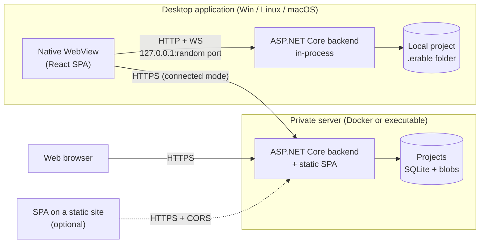

# Erable — Technical direction

## 1. Summary of the decisions

| Topic | Choice | In one sentence |
|---|---|---|
| Backend | **C# / .NET 10 (LTS), ASP.NET Core** | A single server executable, which runs locally as well as hosted. |
| Real time | **SignalR** | Presence, change notifications, later co-editing. |
| Frontend | **React + TypeScript + Vite** | A single SPA, served by the backend or deployed as static files. |
| Editor | **CodeMirror 6** | Markdown source with decorations (names instead of IDs, autocompletion). |
| Desktop | **Photino** (**PhotinoX** fork, native WebView) + **in-process** backend | 100 % C# on the native side, ~50 MB, Windows / Linux / macOS. Possible fallback: Electron. |
| Storage | **SQLite (one file per project)** + **content-addressed attachments** on disk | Nothing to install, backup = copying a folder, FTS5 for search. |
| Identifiers | **Random 64-bit UID**, shown in hex (`3F2A 9C14 E07B 5D21`) | Renaming or moving never breaks a reference. |
| API contract | **REST JSON + OpenAPI**, **generated** TypeScript client | Frontend and backend do not drift apart silently. |
| Distribution | **Velopack** (desktop, auto-update) · **Docker image** (server) | One matrix CI pipeline for Windows / Linux / macOS. |

Guiding principle: **one backend, one SPA, three ways to put them together.**
The frontend talks *only* HTTP/WebSocket to the backend, never to the OS directly — this is what makes the desktop shell replaceable and keeps the door open to mobile.

---

## 2. Deployment modes



| Mode | Who serves the SPA | Who serves the API | Auth |
|---|---|---|---|
| **Local desktop** | In-process backend | In-process backend (loopback) | None (local session token, see §9) |
| **Connected desktop** | SPA embedded in the app | Remote server, **through the local backend** (Q9) | Server account (bearer token, kept by the backend) |
| **Web** | The server (or static hosting) | Server | Server account (httpOnly cookie) |
| **Ad hoc server** | `erable serve ./MyWiki --port 5080` | same | Local accounts |
| **Mobile** (browser or Android app, Q11) | The server, loaded in the browser or in the WebView of the app | Server | Server account (httpOnly cookie, as on the web) |

The ad hoc mode comes for free: it is the same executable. It lets someone share a local project on the LAN without Docker.

**Version compatibility.** When the desktop app connects to a server, it calls `GET /api/info` (API version, format version). The API is prefixed with `/api/v1`. A SPA more recent than a server shows a clear message rather than breaking.

---

## 3. Solution architecture

```
Erable/
├─ Erable.sln
├─ src/
│  ├─ Erable.Core/          Pure domain: ElementId, entities, validation rules,
│  │                         category inheritance, Markdown reference parser.
│  │                         No IO dependency.
│  ├─ Erable.Storage/       SQLite (Microsoft.Data.Sqlite + Dapper), migrations,
│  │                         FTS5, BlobStore (disk; S3 later).
│  ├─ Erable.Server/        ASP.NET Core host: Minimal API endpoints, SignalR hub,
│  │                         auth, OpenAPI, static files.
│  │                         Standalone executable (server mode).
│  ├─ Erable.Desktop/       Photino shell: starts Erable.Server in-process on
│  │                         loopback, opens the window, native dialogs.
│  └─ web/                  React/TS SPA (pnpm + Vite).
├─ spec/fixtures/           Test cases shared by C# and TS (Markdown syntax, rules).
├─ tests/                   xUnit (Core, Storage, Server) · Vitest (web) · Playwright (e2e).
└─ docs/
```

**Why Dapper rather than EF Core?** The model is small, and the interesting queries (FTS5, filters on properties, recursive inheritance through `WITH RECURSIVE`) are specific SQL anyway. Versioned SQL migrations (`PRAGMA user_version`) are enough and stay readable. EF Core remains an option if a second database engine becomes necessary (§10).

### 3.1 Frontend

| Need | Library |
|---|---|
| Routing | TanStack Router (typed routes: `/p/:projectId/e/:elementId`) |
| Server state / cache | TanStack Query (invalidation triggered by SignalR events) |
| Local UI state | Zustand (tabs, panels, theme) |
| API client | `openapi-typescript` + `openapi-fetch`, generated from the OpenAPI of the backend |
| Editor | CodeMirror 6 + `@codemirror/lang-markdown` + in-house extensions |
| Markdown rendering | unified: `remark-parse` + `remark-gfm` + Erable plugin → React components |
| Sanitization | `rehype-sanitize` (raw HTML disabled by default) |
| UI primitives | Radix UI (accessible menus, dialogs, popovers), in-house styles |
| Tree | In-house virtualized component (`@tanstack/react-virtual`), drag & drop |
| i18n | i18next / react-i18next, one JSON file per language (`fr`, `en`, `de`, `es`) |
| Styles | CSS Modules + design tokens as CSS variables |

**Themes.** Every color is a token on `:root`, redefined under `[data-theme="dark"]`. The "System" choice follows `prefers-color-scheme`. No hard-coded color in components. The backend writes the theme of the user into `<html data-theme>` when serving `index.html`: the first render already has the right theme.

**No durable state in the browser** (decision Q7). On the desktop, the random port changes the origin of the SPA on every launch: `localStorage` and IndexedDB are lost there. Drafts, tree state and preferences therefore go through the API (`me/…`), stored in the application profile locally and in `server.db` in server mode.

**Mobile (M6, F18, decision Q11).** A single SPA: below 720 px wide, the **narrow layout** stacks what the desktop puts side by side (explorer in a drawer, page panel in a tab, full-screen dialogs); with a coarse pointer (`pointer: coarse`), targets offer 44 px and every hover or right-click action has a button. The threshold lives in a single module (`shared/ui/media.ts`) and in the `@media` rules of the CSS Modules (CSS variables cannot be used in a media query). The SPA served by a server is installable (manifest, no service worker: no offline mode). Unchanged rules: no desktop API in the SPA, keyboard shortcuts always doubled by a mouse or touch action.

---

## 4. Identifiers

- Type: `ElementId`, a `readonly record struct` over a `ulong`. `0` is reserved ("none").
- Generation: 64 bits from `RandomNumberGenerator`. For 1 million elements, the probability of a collision is about 3·10⁻⁸; a uniqueness constraint in the database and a new draw cover it.
  *Why random rather than sequential?* Two projects created separately can be merged or imported into one another without renumbering.
- **A single ID space for every kind** (page, folder, category, property, link type, attachment). `[[ID]]` is therefore unambiguous without a kind prefix.
- Formats:
  - canonical (text, URL, JSON): 16 upper-case hex characters, `3F2A9C14E07B5D21`; reading accepts lower case;
  - display: groups of 4, `3F2A 9C14 E07B 5D21`;
  - SQLite: `INTEGER` (unsigned → signed reinterpretation, lossless).
- ⚠️ **In JSON, the ID is always a string.** A JavaScript `number` loses precision beyond 2⁵³: a `ulong` serialized as a number would be silently corrupted. A dedicated `JsonConverter` enforces it on the C# side.

---

## 5. Domain model

### 5.1 Elements and tree

Everything that appears in the explorer is an **element**: `id`, `kind`, `parentId`, `name`, `sortOrder`, creation/modification dates and authors, `revision`, `deletedAt` (trash).

The explorer has one fixed root per kind: **Pages, Categories, Properties, Links** (no "Attachments" root: an attachment is an element of the same ID space, attached to its page, absent from the explorer and found through the palette and search). The roots have fixed IDs shared by every project (`0000000000000001` to `0000000000000004`); values below `0x10000` are reserved and never drawn at random. Under each root:

- **folders** (`Folder` elements), which are only for arranging;
- the elements of the kind of the root.

A **sub-page** is simply a page whose parent is a page. The folder arranges; the sub-page carries meaning (it appears in the "Sub-pages" section of its parent). An element is never moved under another root: a category does not go into *Pages*.

### 5.2 Page

- Extended Markdown content (§6), table of contents computed from the headings.
- Categories: 0..n.
- Property values: those set on the page, plus those inherited from the categories (shown "via PNJ").
- Outgoing and incoming typed links.
- Attachments (they belong to the page, and can be referenced from any page).

### 5.3 Category

- Plain-text description.
- **Single optional parent** (single inheritance: Entité → Personnage → PNJ). Cycles are refused on save.
- Default property values, passed on to child categories and to pages.

**Resolving a value for a page**, by order of priority:

1. value set on the page;
2. value of the most specific category (the deepest in the inheritance chain);
3. default value of the property definition.

If two categories *with no inheritance relation* between them provide different values at the same level, the value is marked **in conflict**. The UI then asks to set it on the page rather than choosing arbitrarily.

Details:
- for each category of the page, the closest category of its chain (itself first) that defines a value is a candidate; a candidate that is an ancestor of another candidate is discarded (PNJ + Marchand: Marchand wins, without conflict);
- two unrelated categories that provide the **same** value are **not** in conflict; the origin cites both;
- a `list<T>` value is resolved like a simple value: the list of the page (or of the most specific category) **replaces** the inherited lists, it is not added to them;
- resolution does not depend on the order of the categories of the page (only the display order of the candidates of a conflict follows it).

### 5.4 Property definition

`name` (displayed), `key` (readable identifier, unique, changeable without breaking anything since references go through the ID), `description`, `type`, `default`, `rules[]`.

| Type | Storage | Available rules |
|---|---|---|
| `bool` | integer 0/1 | — |
| `int` | `INTEGER` | `greater_than`, `greater_or_equal`, `less_than`, `less_or_equal`, `between`, `not_equal` |
| `float` | `REAL` | same as `int` |
| `string` | `TEXT` | `min_length`, `max_length`, `match` (regex), `not_empty` |
| `text` (multi-line) | `TEXT` | `max_length` |
| `enum` | `TEXT` (key of the option) | `in` (allowed subset) |
| `date` | ISO 8601 `TEXT` | `after`, `before` |
| `ref` | ID | `kind` (page / category), `in_category` |
| `list<T>` | several rows | `min_count`, `max_count` + rules of `T` |

Rules are **data**, not code: `{ "op": "less_or_equal", "value": 60 }`. They are evaluated by `Erable.Core` (the authority) and duplicated in TypeScript for instant feedback in the editor. The case set in `spec/fixtures/rules/` guarantees that both implementations give the same result.

**Validation warns, it does not block.** Adding a rule to a property already in use ("2 pages breaking the rules") must not make those pages impossible to save. Violations are stored and exposed (badge, "breaking the rules" search filter).

### 5.5 Link type and link

- Link type: `name`, `description`, and an optional `inverseName` ("mentor of" / "student of") to label incoming links properly.
- Link: `(sourceId, linkTypeId, targetId)`, directed, without a folder constraint.

### 5.6 Implicit references

On every save, the backend extracts every `[[ID]]` and `![[ID]]` reference from the Markdown into an index table. It feeds:

- the "incoming links" and "Used by";
- the warning on deletion ("5 pages reference this element");
- the detection of broken references.

---

## 6. Extended Markdown

Basis: **CommonMark + GFM** (tables, task lists, strikethrough, autolinks). Raw HTML **disabled** (multi-user security, §9).

### 6.1 Added syntax

| Syntax | Effect | Rendered example |
|---|---|---|
| `[[ID]]` | Link to an element, label = its **current** name | Capitaine Orsen |
| `[[ID\|text]]` | Link with a free label | "her mentor" |
| `[[ID#anchor]]` | Link to a heading of the target page | Hautbois › Histoire |
| `![[ID]]` | Embed of an attachment (image, video, audio, PDF; otherwise a file card) | image |
| `![[ID\|caption]]` | Embed with a caption | |
| `![[ID]]{width=320 align=right}` | Optional display attributes | |

`ID` = exactly 16 hexadecimal characters: no ambiguity with text between brackets. A reference to a deleted or nonexistent element is shown as a broken link (dedicated style + tooltip), never as a rendering error.

Anchors: by default, a slug generated from the heading (renaming a heading therefore breaks the anchors that target it). An explicit ID is possible with `## History {#history}` for anchors that should stay stable.

### 6.2 In the editor

- The file always contains the raw IDs. CodeMirror shows a **pill with the name** in their place (atomic decoration: the cursor jumps over the pill in one step). The "Show raw IDs" button turns these decorations off.
- **Insert palette**: opened by typing `[[` or `![[` (like Obsidian), or with a shortcut (§11.3). Fuzzy search, All / Pages / Attachments / Categories / Properties tabs, `Enter` for a link, `Shift+Enter` for an embed, `Tab` to change the kind.
- Dropping or pasting a file: it is uploaded as an attachment of the page, then `![[ID]]` is inserted.

### 6.3 Two parsers, one specification

Rendering happens on the frontend (remark plugin). The backend needs to extract the references and the plain text for the search index (**Markdig** extension). To keep the two from diverging, the grammar of the extensions is deliberately minimal, **written in `docs/markdown-syntax.md`**, and covered by `spec/fixtures/markdown/*.json` (input → expected references), run by xUnit **and** Vitest.

---

## 7. Storage

### 7.1 Format of a project

```
MyWiki/
├─ erable.json              Manifest: formatVersion, projectId (16 hex, like an ElementId), name,
│                           content language, creation date
├─ erable.db                SQLite (WAL mode): elements, contents, revisions, indexes
├─ erable.lock              Single-instance lock, present while the project is open (F16.R2)
└─ blobs/
   └─ 3a/7f/3a7f…e1         Attachments, named by their SHA-256
```

"Opening a project like in an IDE" = opening this folder. `formatVersion` equals the schema version (`PRAGMA user_version`); SQL migrations are embedded and each applied in a transaction, after an `erable.db.bak-<date>` backup. `erable.lock` is opened without sharing (exclusive `flock` lock on Linux and macOS): the system releases it if the process dies, so there is never a stale lock; it is deleted on close. The list of recent projects, the preferences of the user and the place of the desktop window (`window.json`: size, position, maximized or not) are in the application profile (`%APPDATA%/Erable`, `~/.config/erable`, `~/Library/Application Support/Erable`), not in the project.

In server mode, each project is a folder of this kind under `data/projects/<projectId>/`, plus a `data/server.db` database for accounts and rights.

### 7.2 Why SQLite

- **Cheap**: no database server to install, monitor or pay for, locally as well as on the server.
- **Efficient**: reads in microseconds, ACID transactions, built-in FTS5, WAL mode (concurrent reads during a write). More than enough for a team of a few dozen editors.
- **Easy to back up**: a project fits in one file and one folder. For continuous backup on the server, **Litestream** replicates to S3-compatible storage for a few cents a month.
- **A single code path** for local and server.

### 7.3 Why attachments live outside the database

- The database stays small and fast; videos are streamed with `Range` requests (native in ASP.NET Core).
- Content addressing (SHA-256) deduplicates for free: the same image attached to ten pages is stored only once.
- The name, MIME type, size and owner page are in the `attachments` table. The blob is only content.
- `IBlobStore` interface: disk implementation in v1, S3/MinIO possible later without touching the rest.
- A garbage collector deletes the blobs that no attachment and no revision references any more.

### 7.4 Schema (sketch)

```sql
elements        (id PK, kind, parent_id, name, sort_order, revision,
                 created_at, created_by, updated_at, updated_by, deleted_at,
                 deleted_root, deleted_by, deleted_orphan)   -- trash (format v3)
page_contents   (page_id PK, markdown, plain_text)          -- plain_text for FTS
revisions       (element_id, revision, author, at, snapshot BLOB)  -- compressed JSON
categories      (id PK, parent_category_id, description)
page_categories (page_id, category_id, sort_order)
property_defs   (id PK, key UNIQUE, type, default_json, rules_json, enum_json)
property_values (owner_id, property_id, idx,                -- owner = page or category; idx 0 (scalar),
                 v_int, v_real, v_text, v_ref)              -- 0..n-1 (list), -1 (empty list); typed columns → SQL filters
resolved_values (page_id, property_id, idx, v_*, origin, source_id)  -- derived: effective value after inheritance
link_types      (id PK, description, inverse_name)
links           (id PK, source_id, link_type_id, target_id, created_at, created_by)
refs            (source_id, target_id, anchor, is_embed)    -- index derived from the Markdown
attachments     (id PK, page_id, file_name, mime, size, sha256)
validation_issues (owner_id, property_id, rule_index, rule_op, rule_json, item_index)  -- derived
user_activity   (user_id, element_id, last_viewed_at)       -- "recently viewed"
search_fts      USING fts5(name, plain_text, tokenize='unicode61 remove_diacritics 2')   -- kept by triggers from the search_source view (format v4)
```

- **History**: every save creates a revision (compressed JSON snapshot of the element). This is cheap on text and essential as soon as there are several editors (view, compare, restore). "Recently edited" follows directly from this table.
- **Trash**: logical deletion (`deleted_at`), emptied manually or after N days (automatic emptying is not implemented). A deletion is an **entry**: `deleted_root` designates the element deleted by the user and carries the same value for everything that goes with it (sub-pages, content of a folder, attachments); an element deleted earlier keeps its own entry. Restoring puts the whole entry back, at its original location or, if the parent no longer exists, at the root of its kind. `deleted_orphan` is 1 when the parent of the entry has been permanently erased (it is then attached to the root). Emptying deletes the rows and their dependencies (values, links, revisions, attachments), then the blobs that nothing references any more.
- `remove_diacritics`: "col gele" finds "Col gelé". **Search index** (format v4): the `search_source` view defines what is searchable (live elements other than roots; name + plain text of a page, or description of a category, a property, a link type) and triggers copy every write into `search_fts`, in its transaction; `erable doctor --fix` rebuilds it. The text typed by the user never reaches FTS5 as is (words in quotes, last word as a prefix).
- **Storage conventions**: IDs as signed `INTEGER`; dates as UTC ISO 8601 text to the millisecond (`2026-10-13T08:00:00.000Z`), sortable and readable; element kinds as text (`page`, `folder`…); `STRICT` tables. The owner of an attachment is the parent of its element (no duplicated `page_id` column); `revisions.blob_sha256` keeps the blob of an attachment revision alive against the garbage collector.

### 7.5 What this choice does not do well

A SQLite file **does not version well in Git** and **must not be shared through Dropbox/OneDrive or a network share** (risk of corruption with concurrent writes). Collaboration goes through server mode. Versioning projects in Git is not a need (decision Q2): the revision history (§7.4) takes its place.

---

## 8. API and real time

### 8.1 REST (`/api/v1/projects/{projectId}/…`)

| Resource | Operations |
|---|---|
| `tree` | lightweight full tree (id, kind, parent, name, order), loaded once then kept up to date by the events |
| `elements/{id}` | GET, PATCH (rename, move, reorder), DELETE (→ trash) |
| `pages`, `categories`, `properties`, `link-types` | typed CRUD |
| `pages/{id}/content` | GET / PUT with `If-Match: <revision>` |
| `pages/{id}/attachments` | multipart upload, download with `Range` |
| `elements/{id}/backlinks` | incoming references and links |
| `elements/{id}/revisions` | history, diff, restore |
| `search` | text + filters (kind, categories with sub-categories, conditions on properties, modification date, breaking the rules) + sorting + pagination |
| `resolve?ids=…` | names and kinds of N IDs in one call (editor pills, rendering) |
| `me/recent` | viewed / edited |

### 8.2 SignalR (`/hubs/project`)

- **Events**: `ElementChanged`, `ElementMoved`, `ElementDeleted`, `TreeChanged`. The client invalidates its TanStack Query cache accordingly, without polling.
- **Presence**: who is viewing or editing which page, and which section ("Camille R. is also editing this page — History section" banner).

### 8.3 Concurrent editing

**v1 — optimistic concurrency + three-way merge, on the server.** Every save sends the base revision. If the page has changed in the meantime, **the server** merges (base = snapshot of the original revision, theirs, ours) in the transaction of the save, with `Erable.Core.Merge`: a single implementation, tested with properties, valid for every client. Changes to different sections, by far the most frequent case, merge without intervention (the response says so); a real conflict (the same words changed differently) answers `409` with the three versions of each passage and opens a resolution view on the client. Together with the presence indicator, this is enough for a small team.

**v2 — live co-editing (CRDT).** It will be done with **Yjs** on the client (existing CodeMirror integration, `y-codemirror.next`), the backend only relaying and persisting the updates as opaque blobs, and the client sending the resulting Markdown on each save. **Not in v1** (decision Q3): it is the most expensive feature of the project and it does not call the rest of the architecture into question. In v1, the presence banner says "Camille R. is also editing this page — your changes will be merged when you save".

---

## 9. Security

- **Loopback server of the desktop**: listens only on `127.0.0.1`, random port. A random token (256 bits) is generated at launch, passed to the WebView and required on every API, hub and test request. The `Host` header is checked (protection against *DNS rebinding*), and so is the `Origin` header of non-GET requests (CSRF). Without this, any site open in a browser or any local process could read the projects.
  - *Transmission*: the shell opens `http://127.0.0.1:<port>/#session=<token>`. A fragment is never sent to the server, hence never logged. The SPA erases it from the URL at once and exchanges it once (`POST /api/session`, `X-Erable-Session` header) for an `HttpOnly; SameSite=Strict` cookie, which the WebView then attaches to every request, WebSocket and `` included, without the token being readable by a script.
  - Only the static shell of the SPA (`index.html`, `/assets`) is served without a token: it contains no user data.
- **Server mode**: ASP.NET Core Identity password hasher (local accounts, hashed passwords). httpOnly cookie for the browser, bearer token for the desktop app. OIDC (Keycloak, Entra, Google) later. Roles **per project only** (decision Q5): reader, editor, administrator. No permissions per folder or per page.
- **Content**: raw HTML disabled and rendering sanitized (XSS between users). Attachments are served with `Content-Disposition` and `X-Content-Type-Options: nosniff`. SVG and HTML are downloaded, never rendered inline.
- **Security headers** (every response): `X-Content-Type-Options: nosniff`, `X-Frame-Options: SAMEORIGIN`, `Referrer-Policy: no-referrer`. The shell of the SPA adds a `Content-Security-Policy` (`default-src 'self'`, scripts from the origin only, `frame-ancestors 'self'` against *clickjacking*, `base-uri 'none'`, `object-src 'none'`). Accepted exceptions: `style-src 'unsafe-inline'` (Radix UI and CodeMirror inject styles) and `http:`/`https:` images (external images in pages). Framing by the same origin stays allowed: an attached PDF is shown in an `iframe` of the page. HSTS is set by the reverse proxy (`deploy/Caddyfile`).
- **Limits**: configurable maximum attachment size, quotas per project in server mode.
- TLS provided by a reverse proxy (Caddy recommended: automatic certificates).

---

## 10. Desktop: choice of the shell

| | **Photino** (chosen, PhotinoX fork) | Electron | Tauri 2 |
|---|---|---|---|
| Shell language | C# | JS/Node | Rust |
| .NET backend | in-process, a single process | sidecar (2 processes) | sidecar |
| Size | ~50 MB (.NET runtime included) | ~150 MB+ | ~50 MB |
| Rendering engine | WebView2 / WebKitGTK / WKWebView | the same Chromium everywhere | like Photino |
| Maturity / tooling | modest | very high | high |

**Choice: Photino, through the maintained PhotinoX fork** (decision Q6), to stay in C# and in a single process. This choice remains reversible: the shell only (1) starts the backend, (2) opens the window, (3) exposes three or four native functions (folder picker, open a file with the system application, reveal in the file explorer). If Photino causes problems, we switch to Electron by replacing only `Erable.Desktop`.

**Folder dropped on the window (E2E-16-07)**: the WebView never gives the page the path of a dropped folder. Left without a handler, the drop makes the WebView navigate to `file:///…`; the shell cancels every `file:` navigation (`NavigationStarting`, PhotinoX) and, if it is a folder, reports it to the SPA through the SSE stream (`folderDropped`), which opens it like "Open a folder…". The SPA therefore never leaves its origin.

**Native functions**: always through the API (`/api/v1/native/*`, `…/attachments/{id}/open|reveal`), never through a JavaScript bridge, and behind `INativeBridge` on the server side (404 `native.unavailable` in server mode):
- folder picker (`Ctrl+O`), window title (current project), open with the system application (named copy in `<temp>/erable-open/`, **programs and scripts refused**), reveal in the file explorer;
- **closing** (F16.R3): the SPA reports its unsaved changes (`PUT /native/window`); if the window is closed with changes, the shell keeps it open and warns the SPA through an SSE stream (`GET /native/events`), which asks "Save / Discard / Cancel" then confirms (`POST /native/window/close`). With no SPA listening, the window closes (drafts are already saved). Shutting down closes the projects (WAL checkpoint, lock released);
- **single instance per project** (F16.R2): each instance announces itself in `<profile>/instances/<pid>-<port>.json` (port, IPC token distinct from the session token). An instance that finds a project locked — at launch with `Erable.Desktop <folder>` or from the home screen — calls `POST /ipc/activate` on the others: the one that has the project comes to the foreground, the second one stops without a window.

**Risk to clear in milestone M0**: WebKitGTK on Linux has rendering and performance differences with Chromium. The CodeMirror editor, drag & drop in the tree and video playback are validated on the three OSes from the start.

**Packaging**: self-contained `dotnet publish` per RID (`win-x64`, `linux-x64`, `osx-arm64`, `osx-x64`), then **Velopack** (installer and automatic update on the three OSes, AppImage on Linux). Server: Docker image based on `mcr.microsoft.com/dotnet/aspnet` (*chiseled* variant).

---

## 11. Notes on the constraints of the brief

### 11.1 Points of attention

1. **`ulong` and JavaScript**: see §4. IDs as hex strings everywhere outside the database. An easy mistake to make and a very painful one to fix afterwards.
2. **Live co-editing**: the brief does not require it. It is the most expensive item; it is postponed to v2 (§8.3).
3. **Multi-language = interface only.** The interface is translated (FR/EN/DE/ES); the content of the pages is in **the language of the project**, set at its creation in `erable.json`. It is used to choose the language of the default labels (names of the tree roots, project templates) and may differ from the interface language of each user.
4. **Several categories per page** (decision Q4): competing default values are possible. The rule "the most specific wins, otherwise an explicit conflict" (§5.3) applies.
5. **Validation rules**: as warnings rather than blocks (§5.4). Otherwise, changing a rule retroactively blocks existing pages.
6. **Folders and sub-pages**: two ways to build a hierarchy, with distinct roles (arranging versus meaning, §5.1). This must be said clearly in the UI to avoid confusion.
7. **Heading anchors**: they break when a heading is renamed, unlike element IDs. Hence the optional explicit anchors (§6.1).

### 11.2 Local projects and collaboration

"Local" and "editable by several users" only combine through a server. Putting a local project in a shared or synchronized folder is **not** a supported way to collaborate (§7.5). In return, the `erable serve` command (§2) makes going from local to shared trivial.

### 11.3 The Alt+Space shortcut

To avoid as a default shortcut:

- **Windows**: Alt+Space opens the system menu of the window; it is also the default shortcut of PowerToys Run.
- **macOS**: ⌥+Space inserts a non-breaking space (especially on AZERTY keyboards) and is often used by Alfred or Raycast.
- **Linux**: taken by several window managers.

Proposal: primary trigger by typing `[[` (no possible conflict, discoverable), plus a **configurable** shortcut, by default `Ctrl+Space` on Windows and Linux, `⌘+Shift+K` on macOS (where `⌃Space` changes the input source). The shortcut table is data, editable in the preferences.

### 11.4 Distribution costs

To avoid "unrecognized application" warnings, an Apple Developer account (~$99/year, signing and notarization) and a Windows code signing certificate (from ~$100–300/year depending on the option, Azure Trusted Signing being the cheapest) are needed. On Linux, nothing to pay. This does not block the first versions, but it must be planned before a wide distribution.

---

## 12. Milestones

| Milestone | Content | Exit criterion |
|---|---|---|
| **M0 — Skeleton** | Solution, 3-OS matrix CI, Photino + loopback Kestrel + "hello" SPA, OpenAPI client generation, theme tokens | The app installs and opens on the 3 OSes; CodeMirror tested under WebKitGTK |
| **M1 — Local core** | Project format, home (new / open / recent), tree (folders, moving, renaming), Markdown pages, `[[ID]]`, `![[ID]]`, attachments, insert palette, TOC | A complete single-user wiki can be written, without properties |
| **M2 — Structure** | Categories (inheritance), property definitions, values, rules, link types and links, backlinks, trash | Category / Property screens and page side panel complete |
| **M3 — Finding** | FTS5, Ctrl+K search, filter page, recently viewed / edited, history and restore | Search screen complete |
| **M4 — Server** | Accounts, roles, multiple projects, SignalR (events, presence), optimistic concurrency + merge, Docker, connected desktop mode | Two users edit the same project without data loss |
| **M5 — Polish** | Complete i18n, accessibility, configurable shortcuts, Velopack + updates, documented Litestream backup | Distributable version 1.0 |
| **M6 — Mobile** | SPA adapted to phones (F18), manifest, Android app as a client of servers (F19), signed APK in the release | The `@mobile` journeys pass on an emulated phone; the APK of the release opens a server and edits a page |
| **v2 and later** | CRDT co-editing, OIDC, S3 storage, local projects on mobile | — |

---

## 13. Decisions

- **Q1.** Multi-language = interface only. Pages are written in the language of the project; no translated pages.
- **Q2.** No Git versioning of projects. SQLite stays the source of truth; no text export planned.
- **Q3.** Live co-editing in v2. v1 uses optimistic concurrency with three-way merge (§8.3).
- **Q4.** A page can have several categories (resolution of values: §5.3).
- **Q5.** Permissions per project only (§9).
- **Q6.** Desktop shell: Photino (§10). Electron remains the fallback. *Finding (Oct. 2026)*: Photino.NET has had no code commit since January 2025; everything that depends on Photino is isolated in `PhotinoShell`. *Decision (15 Oct. 2026)*: **switch to PhotinoX 5.3.5** (Apache-2.0, targets .NET 10), which exposes the `NavigationStarting` event needed for dropping a folder; Linux and macOS remain to be checked on this fork.
- **Q7.** No durable state in the browser (§3.1): preferences, drafts and interface state are stored by the backend and exposed by the API; the backend injects the theme (and, eventually, the language) into `index.html`. Rejected alternative: a fixed-origin Photino custom URL scheme (more fragile depending on the WebView).
- **Q8.** Accounts and access in server mode. Passwords hashed by the ASP.NET Core Identity hasher (without EF Core nor the Identity cookie scheme); opaque revocable sessions, stored by hash in `data/server.db` (`HttpOnly` `SameSite=Strict` cookie + `Origin` check, or a bearer token for the connected desktop). A non-member gets **404** (no difference from a nonexistent project), a member with an insufficient role **403**. Every endpoint declares its access rule (`AccessRule`); without a rule it is refused. Paths of the machine (creating or opening a folder) are reserved to the desktop.
- **Q9.** The connected desktop talks to the server **through its own backend**: the SPA never calls the server directly; the desktop backend recognizes the projects of a server and forwards the requests (and the SignalR hub) with the bearer token, kept in the system vault (DPAPI, Keychain, libsecret, otherwise memory). The token never reaches JavaScript, authenticated media work and CORS is not required (it stays available for a third-party SPA). Rejected alternative: direct calls from the SPA to the server (token in the memory of the page, no authenticated media).
- **Q10.** Markdown safety limits (docs/markdown-syntax.md §6): size, line length, repetitions, nesting and paragraph length are bounded by a linear pre-scan, refused with 422 on save (Core) and warned about on the client; an existing page that exceeds them is shown as plain text. They block, unlike property rules (§A-5.4), because they are safeguards against saturation and not business rules. Rejected alternative: fixing Markdig and remark.
- **Q11.** Mobile (M6): **the Android app is a client of Erable servers**, written in **.NET for Android** (C#, like the rest). It keeps a list of servers, checks `GET /api/info` before adding one, then opens the SPA **served by the server** in a WebView restricted to its origin: authentication by the web cookie, no CORS, nothing of the SPA or the backend to embed. The `src/Erable.Android` project is outside `Erable.sln` (the `android` workload is not required for the rest); its pure logic is tested by `tests/Erable.Android.Tests`, which compiles its sources. Distribution: signed APK attached to the GitHub release (Play Store later). Rejected alternatives: local projects on the phone (ASP.NET Core is not supported on Android), Capacitor (the embedded SPA would call the server cross-origin, contrary to Q9), Kotlin (a second language and Gradle, for a lighter APK).
