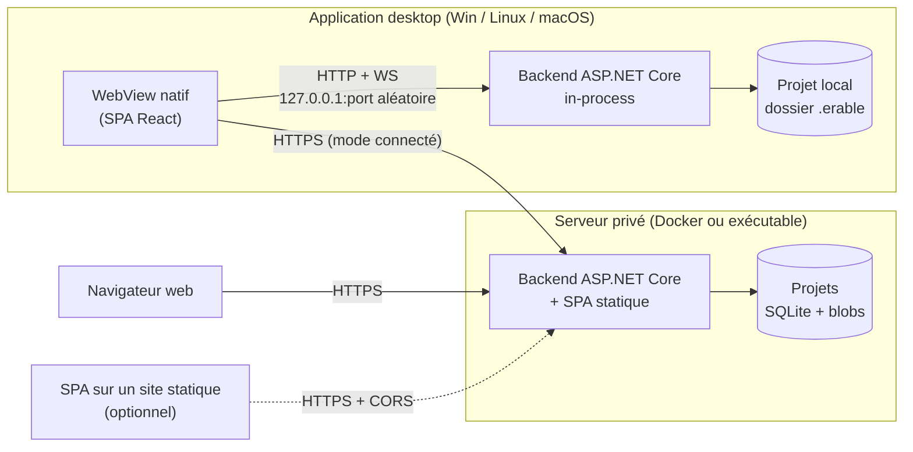

# Erable — Orientation technique

> Statut : **validé** · Version 0.3 · 13 octobre 2026
> Portée : choix de stack, architecture, modèle de données, stockage, formats, découpage en jalons.
> Référence UI : `mockups/Erable — Wiki local.html` (accueil, page, édition, catégorie, propriété, recherche).

---

## 1. Résumé des décisions

| Sujet | Choix | En une phrase |
|---|---|---|
| Backend | **C# / .NET 10 (LTS), ASP.NET Core** | Un seul exécutable serveur, qui tourne aussi bien en local qu'hébergé. |
| Temps réel | **SignalR** | Présence, notifications de modification, plus tard co-édition. |
| Frontend | **React + TypeScript + Vite** | Une SPA unique, servie par le backend ou déployée en statique. |
| Éditeur | **CodeMirror 6** | Markdown source avec décorations (noms à la place des ID, autocomplétion). |
| Desktop | **Photino** (fork **PhotinoX**, WebView natif) + backend **in-process** | 100 % C# côté natif, ~50 Mo, Windows / Linux / macOS. Repli possible : Electron. |
| Stockage | **SQLite (un fichier par projet)** + **pièces jointes adressées par contenu** sur disque | Zéro service à installer, sauvegarde = copier un dossier, FTS5 pour la recherche. |
| Identifiants | **UID 64 bits aléatoire**, affiché en hexa (`3F2A 9C14 E07B 5D21`) | Renommer ou déplacer ne casse jamais une référence. |
| Contrat API | **REST JSON + OpenAPI**, client TypeScript **généré** | Front et back ne divergent pas silencieusement. |
| Distribution | **Velopack** (desktop, auto-update) · **image Docker** (serveur) | Un pipeline CI matriciel Windows / Linux / macOS. |

Principe directeur : **un seul backend, une seule SPA, trois façons de les assembler.**
Le frontend ne parle *que* HTTP/WebSocket au backend, jamais à l'OS directement — c'est ce qui rend le shell desktop interchangeable et garde la porte ouverte au mobile.

---

## 2. Modes de déploiement



| Mode | Qui sert la SPA | Qui sert l'API | Auth |
|---|---|---|---|
| **Desktop local** | Backend in-process | Backend in-process (loopback) | Aucune (jeton de session local, cf. §9) |
| **Desktop connecté** | SPA embarquée dans l'app | Serveur distant | Compte serveur (jeton bearer) |
| **Web** | Le serveur (ou un hébergement statique) | Serveur | Compte serveur (cookie httpOnly) |
| **Serveur ad hoc** | `erable serve ./MonWiki --port 5080` | idem | Comptes locaux |

Le dernier mode est gratuit : c'est le même exécutable. Il permet à quelqu'un de partager un projet local sur le LAN sans Docker.

**Compatibilité de versions.** Quand l'app desktop se connecte à un serveur, elle appelle `GET /api/info` (version d'API, version de format). L'API est préfixée `/api/v1`. Une SPA plus récente qu'un serveur affiche un message clair plutôt que de casser.

---

## 3. Architecture de la solution

```
Erable/
├─ Erable.sln
├─ src/
│  ├─ Erable.Core/          Domaine pur : ElementId, entités, règles de validation,
│  │                         héritage de catégories, parseur des références Markdown.
│  │                         Aucune dépendance IO.
│  ├─ Erable.Storage/       SQLite (Microsoft.Data.Sqlite + Dapper), migrations,
│  │                         FTS5, BlobStore (disque ; S3 plus tard).
│  ├─ Erable.Server/        Hôte ASP.NET Core : endpoints Minimal API, hub SignalR,
│  │                         auth, OpenAPI, service des fichiers statiques.
│  │                         Exécutable autonome (mode serveur).
│  ├─ Erable.Desktop/       Shell Photino : démarre Erable.Server in-process sur
│  │                         loopback, ouvre la fenêtre, dialogues natifs.
│  └─ web/                  SPA React/TS (pnpm + Vite).
├─ spec/fixtures/           Cas de test partagés C# ↔ TS (syntaxe Markdown, règles).
├─ tests/                   xUnit (Core, Storage, Server) · Vitest (web) · Playwright (e2e).
└─ docs/
```

**Pourquoi Dapper plutôt qu'EF Core ?** Le modèle est petit, les requêtes intéressantes (FTS5, filtres sur propriétés, héritage récursif via `WITH RECURSIVE`) sont du SQL spécifique de toute façon. Des migrations SQL versionnées (`PRAGMA user_version`) suffisent et restent lisibles. EF Core reste envisageable si un second SGBD devient nécessaire (§10).

### 3.1 Frontend

| Besoin | Bibliothèque |
|---|---|
| Routage | TanStack Router (routes typées : `/p/:projectId/e/:elementId`) |
| État serveur / cache | TanStack Query (invalidation déclenchée par les événements SignalR) |
| État UI local | Zustand (onglets, panneaux, thème) |
| Client API | `openapi-typescript` + `openapi-fetch`, généré depuis l'OpenAPI du backend |
| Éditeur | CodeMirror 6 + `@codemirror/lang-markdown` + extensions maison |
| Rendu Markdown | unified : `remark-parse` + `remark-gfm` + plugin Erable → composants React |
| Sanitisation | `rehype-sanitize` (HTML brut désactivé par défaut) |
| Primitives UI | Radix UI (menus, dialogues, popovers accessibles), styles maison |
| Arbre | Composant maison virtualisé (`@tanstack/react-virtual`), drag & drop |
| i18n | i18next / react-i18next, fichiers JSON par langue (`fr`, `en`, `de`, `es`) |
| Styles | CSS Modules + design tokens en variables CSS (repris du mockup) |

**Thèmes.** Toutes les couleurs sont des tokens sur `:root`, redéfinis sous `[data-theme="dark"]`. Le choix « Système » suit `prefers-color-scheme`. Aucune couleur en dur dans les composants. Le backend écrit le thème de l'utilisateur dans `<html data-theme>` en servant `index.html` : le premier rendu a déjà le bon thème.

**Aucun état durable dans le navigateur** (décision Q7). En desktop, le port aléatoire change l'origine de la SPA à chaque lancement : `localStorage` et IndexedDB y sont perdus. Brouillons, état de l'arbre et préférences passent donc par l'API (`me/…`), stockés dans le profil applicatif en local et dans `server.db` en mode serveur.

**Mobile plus tard.** Règles à respecter dès maintenant : pas d'API desktop dans la SPA, layout en grille dont les panneaux latéraux peuvent se replier, cibles cliquables ≥ 32 px, raccourcis clavier toujours doublés d'une action à la souris. Le premier « mobile » sera la SPA en PWA sur un serveur.

---

## 4. Identifiants

- Type : `ElementId`, `readonly record struct` sur un `ulong`. `0` est réservé (« aucun »).
- Génération : 64 bits issus de `RandomNumberGenerator`. Pour 1 million d'éléments, la probabilité d'une collision est d'environ 3·10⁻⁸ ; une contrainte d'unicité en base et un nouveau tirage la couvrent.
  *Pourquoi aléatoire et non séquentiel ?* Deux projets créés séparément peuvent être fusionnés ou importés l'un dans l'autre sans renumérotation.
- **Un seul espace d'ID pour tous les types** (page, dossier, catégorie, propriété, type de lien, pièce jointe). `[[ID]]` est donc non ambigu sans préfixe de type.
- Formats :
  - canonique (texte, URL, JSON) : 16 caractères hexa majuscules, `3F2A9C14E07B5D21` ; la lecture accepte les minuscules ;
  - affichage : groupes de 4, `3F2A 9C14 E07B 5D21` (comme le mockup) ;
  - SQLite : `INTEGER` (réinterprétation non signée → signée, sans perte).
- ⚠️ **En JSON, l'ID est toujours une chaîne.** Un `number` JavaScript perd la précision au-delà de 2⁵³ : un `ulong` sérialisé en nombre serait corrompu silencieusement. Un `JsonConverter` dédié l'impose côté C#.

---

## 5. Modèle de domaine

### 5.1 Éléments et arbre

Tout ce qui apparaît dans l'explorateur est un **élément** : `id`, `kind`, `parentId`, `name`, `sortOrder`, dates et auteurs de création/modification, `revision`, `deletedAt` (corbeille).

L'explorateur a une racine fixe par type : **Pages, Catégories, Propriétés, Liens** (décision P-02 : pas de racine « Pièces jointes » ; une pièce jointe est un élément du même espace d'ID, rattaché à sa page, absent de l'explorateur et retrouvé par la palette et la recherche). Les racines ont des ID fixes communs à tous les projets (`0000000000000001` à `0000000000000004`) ; les valeurs inférieures à `0x10000` sont réservées et jamais tirées au hasard. Sous chaque racine :

- des **dossiers** (éléments `Folder`) qui ne servent qu'à ranger ;
- les éléments du type de la racine.

Une **sous-page** est simplement une page dont le parent est une page. Le dossier range ; la sous-page porte un sens (elle apparaît dans la section « Sous-pages » de son parent). On ne déplace pas un élément sous une autre racine : une catégorie ne va pas dans *Pages*.

### 5.2 Page

- Contenu Markdown étendu (§6), table des matières calculée depuis les titres.
- Catégories : 0..n.
- Valeurs de propriétés : celles définies sur la page, plus celles héritées des catégories (affichées « via PNJ », comme sur le mockup).
- Liens typés sortants et entrants.
- Pièces jointes (appartiennent à la page, référençables depuis n'importe quelle page).

### 5.3 Catégorie

- Description en texte simple.
- **Parent optionnel unique** (héritage simple : Entité → Personnage → PNJ). Les cycles sont refusés à l'enregistrement.
- Valeurs de propriétés par défaut, transmises aux catégories enfants et aux pages.

**Résolution d'une valeur pour une page**, par ordre de priorité :

1. valeur définie sur la page ;
2. valeur de la catégorie la plus spécifique (la plus profonde dans la chaîne d'héritage) ;
3. valeur par défaut de la définition de propriété.

Si deux catégories *sans lien d'héritage* entre elles fournissent des valeurs différentes au même niveau, la valeur est marquée **en conflit**. L'UI demande alors de la fixer sur la page plutôt que de choisir arbitrairement.

Précisions (M2-01) :
- pour chaque catégorie de la page, la catégorie la plus proche de sa chaîne (elle-même d'abord) qui définit une valeur est candidate ; une candidate ancêtre d'une autre candidate est écartée (PNJ + Marchand : Marchand l'emporte, sans conflit) ;
- deux catégories sans lien qui fournissent la **même** valeur ne sont **pas** en conflit ; l'origine les cite toutes les deux ;
- une valeur `list<T>` se résout comme une valeur simple : la liste de la page (ou de la catégorie la plus spécifique) **remplace** les listes héritées, elle ne s'y ajoute pas ;
- la résolution ne dépend pas de l'ordre des catégories de la page (seul l'ordre d'affichage des candidates d'un conflit le suit).

### 5.4 Définition de propriété

`name` (affiché), `key` (identifiant lisible, unique, modifiable sans rien casser puisque les références passent par l'ID), `description`, `type`, `default`, `rules[]`.

| Type | Stockage | Règles disponibles |
|---|---|---|
| `bool` | entier 0/1 | — |
| `int` | `INTEGER` | `greater_than`, `greater_or_equal`, `less_than`, `less_or_equal`, `between`, `not_equal` |
| `float` | `REAL` | idem `int` |
| `string` | `TEXT` | `min_length`, `max_length`, `match` (regex), `not_empty` |
| `text` (multiligne) | `TEXT` | `max_length` |
| `enum` | `TEXT` (clé de l'option) | `in` (sous-ensemble autorisé) |
| `date` | `TEXT` ISO 8601 | `after`, `before` |
| `ref` | ID | `kind` (page / catégorie), `in_category` |
| `list<T>` | plusieurs lignes | `min_count`, `max_count` + règles de `T` |

Les règles sont **des données**, pas du code : `{ "op": "less_or_equal", "value": 60 }`. Elles sont évaluées par `Erable.Core` (autorité) et dupliquées en TypeScript pour le retour instantané dans l'éditeur. Le jeu de cas `spec/fixtures/rules.json` garantit que les deux implémentations donnent le même résultat.

**La validation avertit, elle ne bloque pas.** Le mockup montre « 2 pages hors règles » : ajouter une règle à une propriété déjà utilisée ne doit pas rendre ces pages impossibles à enregistrer. Les violations sont stockées et exposées (badge, filtre de recherche « hors règles »).

### 5.5 Type de lien et lien

- Type de lien : `name`, `description`, et `inverseName` optionnel (« mentor de » / « élève de ») pour bien libeller les liens entrants.
- Lien : `(sourceId, linkTypeId, targetId)`, orienté, sans contrainte de dossier.

### 5.6 Références implicites

À chaque enregistrement, le backend extrait du Markdown toutes les références `[[ID]]` et `![[ID]]` dans une table d'index. Elle alimente :

- les « liens entrants » et « Utilisée par » ;
- l'avertissement à la suppression (« 5 pages référencent cet élément ») ;
- la détection des références cassées.

---

## 6. Markdown étendu

Base : **CommonMark + GFM** (tableaux, listes de tâches, barré, autoliens). HTML brut **désactivé** (sécurité multi-utilisateur, §9).

### 6.1 Syntaxe ajoutée

| Syntaxe | Effet | Exemple rendu |
|---|---|---|
| `[[ID]]` | Lien vers un élément, libellé = son nom **actuel** | Capitaine Orsen |
| `[[ID\|texte]]` | Lien avec libellé libre | « son mentor » |
| `[[ID#ancre]]` | Lien vers un titre de la page cible | Hautbois › Histoire |
| `![[ID]]` | Intégration d'une pièce jointe (image, vidéo, audio, PDF ; sinon carte de fichier) | image |
| `![[ID\|légende]]` | Intégration avec légende | |
| `![[ID]]{width=320 align=right}` | Attributs d'affichage optionnels | |

`ID` = exactement 16 caractères hexadécimaux : aucune ambiguïté avec du texte entre crochets. Une référence vers un élément supprimé ou inexistant s'affiche comme un lien cassé (style dédié + infobulle), jamais comme une erreur de rendu.

Ancres : par défaut, un slug généré depuis le titre (renommer un titre casse donc les ancres qui le visent). Un ID explicite est possible avec `## Histoire {#histoire}` pour les ancres qu'on veut stables.

### 6.2 Dans l'éditeur

- Le fichier contient toujours les ID bruts. CodeMirror affiche à leur place une **pastille avec le nom** (décoration atomique : le curseur saute la pastille d'un bloc). Le bouton « Afficher les ID bruts » du mockup désactive ces décorations.
- **Palette d'insertion** : ouverte en tapant `[[` ou `![[` (à la manière d'Obsidian), ou par raccourci (§11.3). Recherche floue, onglets Tout / Pages / Pièces jointes / Catégories / Propriétés, `Entrée` pour un lien, `Maj+Entrée` pour une intégration, `Tab` pour changer de type (repris du mockup).
- Glisser-déposer ou coller un fichier : il est téléversé comme pièce jointe de la page, puis `![[ID]]` est inséré.

### 6.3 Deux parseurs, une spécification

Le rendu se fait côté front (plugin remark). Le backend a besoin d'extraire les références et le texte brut pour l'index de recherche (extension **Markdig**). Pour éviter que les deux divergent, la grammaire des extensions est volontairement minimale, **écrite dans `docs/markdown-syntax.md`**, et couverte par `spec/fixtures/markdown/*.json` (entrée → références attendues), exécutés par xUnit **et** Vitest.

---

## 7. Stockage

### 7.1 Format d'un projet

```
MonWiki/
├─ erable.json              Manifeste : formatVersion, projectId (16 hexa, comme un ElementId), nom,
│                           langue du contenu, date de création
├─ erable.db                SQLite (mode WAL) : éléments, contenus, révisions, index
├─ erable.lock              Verrou mono-instance, présent tant que le projet est ouvert (F16.R2)
└─ blobs/
   └─ 3a/7f/3a7f…e1         Pièces jointes, nommées par leur SHA-256
```

« Ouvrir un projet comme dans un IDE » = ouvrir ce dossier. `formatVersion` est égal à la version du schéma (`PRAGMA user_version`) ; les migrations SQL sont embarquées et appliquées chacune dans une transaction, après une sauvegarde `erable.db.bak-<date>`. `erable.lock` est ouvert sans partage (verrou exclusif `flock` sous Linux et macOS) : le système le libère si le processus meurt, il n'y a donc jamais de verrou périmé ; il est supprimé à la fermeture. La liste des projets récents et les préférences de l'utilisateur sont dans le profil applicatif (`%APPDATA%/Erable`, `~/.config/erable`, `~/Library/Application Support/Erable`), pas dans le projet.

En mode serveur, chaque projet est un dossier de ce type sous `data/projects/<projectId>/`, plus une base `data/server.db` pour les comptes et les droits.

### 7.2 Pourquoi SQLite

- **Économique** : pas de serveur de base de données à installer, à superviser ou à payer, aussi bien en local que sur le serveur.
- **Efficace** : lectures en microsecondes, transactions ACID, FTS5 intégré, mode WAL (lectures concurrentes pendant une écriture). Largement suffisant pour une équipe de quelques dizaines d'éditeurs.
- **Simple à sauvegarder** : un projet tient en un fichier et un dossier. Pour une sauvegarde continue côté serveur, **Litestream** réplique vers un stockage S3-compatible pour quelques centimes par mois.
- **Un seul chemin de code** pour le local et le serveur.

### 7.3 Pourquoi les pièces jointes hors de la base

- La base reste petite et rapide ; les vidéos sont servies en streaming avec les requêtes `Range` (natives dans ASP.NET Core).
- L'adressage par contenu (SHA-256) déduplique gratuitement : une même image attachée à dix pages n'est stockée qu'une fois.
- Le nom, le type MIME, la taille et la page propriétaire sont dans la table `attachments`. Le blob n'est qu'un contenu.
- Interface `IBlobStore` : implémentation disque en v1, S3/MinIO possible plus tard sans toucher au reste.
- Un ramasse-miettes supprime les blobs qu'aucune pièce jointe ni aucune révision ne référence plus.

### 7.4 Schéma (esquisse)

```sql
elements        (id PK, kind, parent_id, name, sort_order, revision,
                 created_at, created_by, updated_at, updated_by, deleted_at)
page_contents   (page_id PK, markdown, plain_text)          -- plain_text pour FTS
revisions       (element_id, revision, author, at, snapshot BLOB)  -- JSON compressé
categories      (id PK, parent_category_id, description)
page_categories (page_id, category_id, sort_order)
property_defs   (id PK, key UNIQUE, type, default_json, rules_json, enum_json)
property_values (owner_id, property_id, idx,                -- owner = page ou catégorie ; idx 0 (scalaire),
                 v_int, v_real, v_text, v_ref)              -- 0..n-1 (liste), -1 (liste vide) ; colonnes typées → filtres SQL
resolved_values (page_id, property_id, idx, v_*, origin, source_id)  -- dérivée (P-07) : valeur effective après héritage
link_types      (id PK, description, inverse_name)
links           (id PK, source_id, link_type_id, target_id, created_at, created_by)
refs            (source_id, target_id, anchor, is_embed)    -- index dérivé du Markdown
attachments     (id PK, page_id, file_name, mime, size, sha256)
validation_issues (owner_id, property_id, rule_index, rule_op, rule_json, item_index)  -- dérivée
user_activity   (user_id, element_id, last_viewed_at)       -- « récemment consultées »
search_fts      USING fts5(name, plain_text, tokenize='unicode61 remove_diacritics 2')
```

- **Historique** : chaque enregistrement crée une révision (instantané JSON compressé de l'élément). C'est peu coûteux sur du texte et indispensable dès qu'il y a plusieurs éditeurs (consulter, comparer, restaurer). « Récemment modifiées » découle directement de cette table.
- **Corbeille** : suppression logique (`deleted_at`), vidée manuellement ou après N jours.
- `remove_diacritics` : « col gele » trouve « Col gelé ».
- **Conventions de stockage** : ID en `INTEGER` signé ; dates en texte UTC ISO 8601 à la milliseconde (`2026-10-13T08:00:00.000Z`), triables et lisibles ; types d'élément en texte (`page`, `folder`…) ; tables `STRICT`. Le propriétaire d'une pièce jointe est le parent de son élément (pas de colonne `page_id` en double) ; `revisions.blob_sha256` garde en vie le blob d'une révision de pièce jointe face au ramasse-miettes.

### 7.5 Ce que ce choix ne fait pas bien

Un fichier SQLite **ne se versionne pas bien dans Git** et **ne doit pas être partagé via Dropbox/OneDrive ou un partage réseau** (risque de corruption avec des écritures concurrentes). La collaboration passe par le mode serveur. Le versionnement Git des projets n'est pas un besoin (décision Q2) : l'historique des révisions (§7.4) en tient lieu.

---

## 8. API et temps réel

### 8.1 REST (`/api/v1/projects/{projectId}/…`)

| Ressource | Opérations |
|---|---|
| `tree` | arbre complet léger (id, kind, parent, nom, ordre), chargé une fois puis tenu à jour par les événements |
| `elements/{id}` | GET, PATCH (renommer, déplacer, réordonner), DELETE (→ corbeille) |
| `pages`, `categories`, `properties`, `link-types` | CRUD typé |
| `pages/{id}/content` | GET / PUT avec `If-Match: <revision>` |
| `pages/{id}/attachments` | upload multipart, téléchargement avec `Range` |
| `elements/{id}/backlinks` | références et liens entrants |
| `elements/{id}/revisions` | historique, diff, restauration |
| `search` | texte + filtres (type, catégories avec sous-catégories, conditions sur propriétés, date de modification, hors règles) + tri + pagination |
| `resolve?ids=…` | noms et types de N ID en un appel (pastilles de l'éditeur, rendu) |
| `me/recent` | consultées / modifiées |

### 8.2 SignalR (`/hubs/project`)

- **Événements** : `ElementChanged`, `ElementMoved`, `ElementDeleted`, `TreeChanged`. Le client invalide son cache TanStack Query en conséquence, sans polling.
- **Présence** : qui consulte ou édite quelle page, et quelle section (bandeau « Camille R. modifie aussi cette page — section Histoire » du mockup).

### 8.3 Édition concurrente

**v1 — concurrence optimiste + fusion à trois voies.** Chaque sauvegarde envoie la révision de base. Si la page a changé entre-temps, le client récupère la version serveur et fusionne (base / la sienne / la leur). Les modifications sur des sections différentes, cas de loin le plus fréquent, fusionnent sans intervention ; un vrai conflit ouvre une vue de résolution. Avec l'indicateur de présence, c'est suffisant pour une petite équipe.

**v2 — co-édition en direct (CRDT).** Le mockup indique « Les changements sont fusionnés en direct ». Ce sera fait avec **Yjs** côté client (intégration CodeMirror existante, `y-codemirror.next`), le backend se contentant de relayer et de persister les mises à jour comme des blobs opaques, et le client envoyant le Markdown résultant à chaque enregistrement. **Hors v1** (décision Q3) : c'est la fonctionnalité la plus coûteuse du projet et elle ne remet pas en cause le reste de l'architecture. En v1, le libellé du mockup devient « Camille R. modifie aussi cette page — vos changements seront fusionnés à l'enregistrement ».

---

## 9. Sécurité

- **Serveur loopback du desktop** : écoute uniquement sur `127.0.0.1`, port aléatoire. Un jeton aléatoire (256 bits) est généré au lancement, transmis au WebView et exigé sur chaque requête d'API, de hub et de test. L'en-tête `Host` est vérifié (protection contre le *DNS rebinding*) et l'en-tête `Origin` des requêtes non GET (CSRF). Sans cela, n'importe quel site ouvert dans un navigateur ou n'importe quel processus local pourrait lire les projets.
  - *Transmission* : le shell ouvre `http://127.0.0.1:<port>/#session=<jeton>`. Un fragment n'est jamais envoyé au serveur, donc jamais journalisé. La SPA l'efface aussitôt de l'URL et l'échange une fois (`POST /api/session`, en-tête `X-Erable-Session`) contre un cookie `HttpOnly; SameSite=Strict`, que le WebView joint ensuite à toutes les requêtes, WebSocket et `` compris, sans que le jeton soit lisible par un script.
  - Seule la coquille statique de la SPA (`index.html`, `/assets`) est servie sans jeton : elle ne contient aucune donnée de l'utilisateur.
- **Mode serveur** : ASP.NET Core Identity (comptes locaux, mots de passe hachés). Cookie httpOnly pour le navigateur, jeton bearer pour l'app desktop. OIDC (Keycloak, Entra, Google) plus tard. Rôles **par projet uniquement** (décision Q5) : lecteur, éditeur, administrateur. Pas de permissions par dossier ou par page.
- **Contenu** : HTML brut désactivé et sanitisation du rendu (XSS entre utilisateurs). Les pièces jointes sont servies avec `Content-Disposition` et `X-Content-Type-Options: nosniff`. SVG et HTML sont téléchargés, jamais rendus inline.
- **Limites** : taille maximale d'une pièce jointe configurable, quotas par projet en mode serveur.
- TLS assuré par un reverse proxy (Caddy recommandé : certificats automatiques).

---

## 10. Desktop : choix du shell

| | **Photino** (retenu, fork PhotinoX) | Electron | Tauri 2 |
|---|---|---|---|
| Langage du shell | C# | JS/Node | Rust |
| Backend .NET | in-process, un seul processus | sidecar (2 processus) | sidecar |
| Taille | ~50 Mo (runtime .NET inclus) | ~150 Mo+ | ~50 Mo |
| Moteur de rendu | WebView2 / WebKitGTK / WKWebView | Chromium identique partout | comme Photino |
| Maturité / outillage | modeste | très élevée | élevée |

**Choix retenu : Photino, via le fork maintenu PhotinoX** (décision Q6), pour rester en C# et en un seul processus. Ce choix reste réversible : le shell ne fait que (1) démarrer le backend, (2) ouvrir la fenêtre, (3) exposer trois ou quatre fonctions natives (sélecteur de dossier, ouvrir un fichier avec l'application système, révéler dans l'explorateur). Si Photino pose problème, on passe à Electron en remplaçant uniquement `Erable.Desktop`.

**Dossier déposé sur la fenêtre (E2E-16-07)** : le WebView ne donne jamais à la page le chemin d'un dossier déposé. Laissé sans gestionnaire, le dépôt fait naviguer le WebView vers `file:///…` ; le shell annule toute navigation `file:` (`NavigationStarting`, PhotinoX) et, si c'est un dossier, le signale à la SPA par le flux SSE (`folderDropped`), qui l'ouvre comme « Ouvrir un dossier… ». La SPA ne quitte donc jamais son origine.

**Fonctions natives (M1-17)** : toujours par l'API (`/api/v1/native/*`, `…/attachments/{id}/open|reveal`), jamais par un pont JavaScript, et derrière `INativeBridge` côté serveur (404 `native.unavailable` en mode serveur) :
- sélecteur de dossier (`Ctrl+O`), titre de fenêtre (projet courant), ouvrir avec l'application système (copie nommée dans `<temp>/erable-open/`, **programmes et scripts refusés**), révéler dans l'explorateur ;
- **fermeture** (F16.R3) : la SPA signale ses modifications non enregistrées (`PUT /native/window`) ; si la fenêtre est fermée avec des modifications, le shell la garde ouverte et prévient la SPA par un flux SSE (`GET /native/events`), qui demande « Enregistrer / Abandonner / Annuler » puis confirme (`POST /native/window/close`). Sans SPA à l'écoute, la fenêtre se ferme (les brouillons sont déjà enregistrés). L'arrêt ferme les projets (checkpoint WAL, verrou libéré) ;
- **mono-instance par projet** (F16.R2, P-04) : chaque instance s'annonce dans `<profil>/instances/<pid>-<port>.json` (port, jeton IPC distinct du jeton de session). Une instance qui trouve un projet verrouillé — au lancement `Erable.Desktop <dossier>` ou depuis l'accueil — appelle `POST /ipc/activate` des autres : celle qui a le projet passe au premier plan, la seconde s'arrête sans fenêtre.

**Risque à lever au jalon M0** : WebKitGTK sous Linux a des écarts de rendu et de performance avec Chromium. On valide dès le début l'éditeur CodeMirror, le drag & drop dans l'arbre et la lecture vidéo sur les trois OS.

**Packaging** : `dotnet publish` autonome par RID (`win-x64`, `linux-x64`, `osx-arm64`, `osx-x64`) puis **Velopack** (installeur et mise à jour automatique sur les trois OS, AppImage sous Linux). Serveur : image Docker basée sur `mcr.microsoft.com/dotnet/aspnet` (variante *chiseled*).

---

## 11. Remarques sur les contraintes du pitch

### 11.1 Points d'attention

1. **`ulong` et JavaScript** : voir §4. ID en chaîne hexa partout hors de la base. Une erreur facile à commettre et très pénible à corriger après coup.
2. **Co-édition en direct** : le mockup la montre, le pitch ne l'exige pas. C'est le poste le plus coûteux ; elle est reportée en v2 (§8.3).
3. **Multi-langage = interface uniquement.** L'interface est traduite (FR/EN/DE/ES, comme sur le mockup) ; le contenu des pages est dans **la langue du projet**, fixée à sa création dans `erable.json`. Elle sert à choisir la langue des libellés par défaut (noms des racines de l'arbre, modèles de projet) et peut différer de la langue de l'interface de chaque utilisateur.
4. **Plusieurs catégories par page** (décision Q4) : des valeurs par défaut concurrentes sont possibles. La règle « le plus spécifique gagne, sinon conflit explicite » (§5.3) s'applique.
5. **Règles de validation** : en avertissement plutôt qu'en blocage (§5.4). Sinon, modifier une règle bloque rétroactivement des pages existantes.
6. **Dossiers et sous-pages** : deux façons de hiérarchiser, avec des rôles distincts (rangement contre sens, §5.1). Il faut le dire clairement dans l'UI pour éviter la confusion.
7. **Ancres de titres** : elles se cassent au renommage d'un titre, contrairement aux ID d'éléments. D'où les ancres explicites optionnelles (§6.1).

### 11.2 Projets locaux et collaboration

« Local » et « modifiable par plusieurs utilisateurs » ne se combinent qu'à travers un serveur. Placer un projet local sur un dossier partagé ou synchronisé n'est **pas** une manière supportée de collaborer (§7.5). En contrepartie, la commande `erable serve` (§2) rend le passage local → partagé trivial.

### 11.3 Le raccourci Alt+Espace

À éviter comme raccourci par défaut :

- **Windows** : Alt+Espace ouvre le menu système de la fenêtre ; c'est aussi le raccourci par défaut de PowerToys Run.
- **macOS** : ⌥+Espace insère une espace insécable (notamment sur clavier AZERTY) et sert souvent à Alfred ou Raycast.
- **Linux** : pris par plusieurs gestionnaires de fenêtres.

Proposition : déclenchement principal en tapant `[[` (aucun conflit possible, découvrable), plus un raccourci **configurable**, par défaut `Ctrl+Espace` sous Windows et Linux, `⌘+Maj+K` sous macOS (où `⌃Espace` change la source de saisie). La table des raccourcis est une donnée, éditable dans les préférences.

### 11.4 Coûts de distribution

Pour éviter les alertes « application non reconnue », il faut un compte Apple Developer (~99 $/an, signature et notarisation) et un certificat de signature de code Windows (à partir de ~100–300 $/an selon l'option, Azure Trusted Signing étant la moins chère). Sous Linux, rien de payant. Ce n'est pas bloquant pour les premières versions internes, mais à prévoir avant une diffusion large.

---

## 12. Jalons

| Jalon | Contenu | Critère de fin |
|---|---|---|
| **M0 — Squelette** | Solution, CI matricielle 3 OS, Photino + Kestrel loopback + SPA « hello », génération du client OpenAPI, tokens de thème | L'app s'installe et s'ouvre sur les 3 OS ; CodeMirror testé sous WebKitGTK |
| **M1 — Cœur local** | Format de projet, accueil (nouveau / ouvrir / récents), arbre (dossiers, déplacement, renommage), pages Markdown, `[[ID]]`, `![[ID]]`, pièces jointes, palette d'insertion, TOC | On écrit un wiki mono-utilisateur complet, sans propriétés |
| **M2 — Structure** | Catégories (héritage), définitions de propriétés, valeurs, règles, types de liens et liens, backlinks, corbeille | Écrans Catégorie / Propriété / panneau latéral de page conformes au mockup |
| **M3 — Retrouver** | FTS5, recherche Ctrl+K, page de filtres, récemment consultées / modifiées, historique et restauration | Écran Recherche conforme au mockup |
| **M4 — Serveur** | Comptes, rôles, multi-projets, SignalR (événements, présence), concurrence optimiste + fusion, Docker, mode desktop connecté | Deux utilisateurs éditent le même projet sans perte de données |
| **M5 — Finition** | i18n complète, accessibilité, raccourcis configurables, Velopack + mises à jour, sauvegarde Litestream documentée | Version 1.0 distribuable |
| **v2 et après** | Co-édition CRDT, PWA mobile, OIDC, stockage S3 | — |

---

## 13. Décisions actées

- **Q1.** Multi-langage = interface uniquement. Les pages sont rédigées dans la langue du projet ; pas de pages traduites.
- **Q2.** Pas de versionnement Git des projets. SQLite reste la source de vérité ; pas d'export texte prévu.
- **Q3.** Co-édition en direct en v2. La v1 utilise la concurrence optimiste avec fusion à trois voies (§8.3).
- **Q4.** Une page peut avoir plusieurs catégories (résolution des valeurs : §5.3).
- **Q5.** Permissions par projet uniquement (§9).
- **Q6.** Shell desktop : Photino (§10). Electron reste le repli si le jalon M0 révèle un blocage. *Constat M0-07 (oct. 2026)* : Photino.NET n'a plus de commit de code depuis janvier 2025 ; tout ce qui dépend de Photino est isolé dans `PhotinoShell`, et le spike M0-08 le compare au fork actif PhotinoX. *Décision M1-17 (15 oct. 2026, P-15)* : **passage à PhotinoX 5.3.5** (Apache-2.0, cible .NET 10), qui expose `NavigationStarting` nécessaire au dépôt de dossier ; Linux et macOS restent à vérifier sur ce fork.
- **Q7.** Aucun état durable dans le navigateur (§3.1) : préférences, brouillons et état de l'interface sont stockés côté backend et exposés par l'API ; le backend injecte le thème (et, à terme, la langue) dans `index.html`. Alternative écartée : schéma d'URL personnalisé Photino à origine fixe (plus fragile selon les WebViews).
