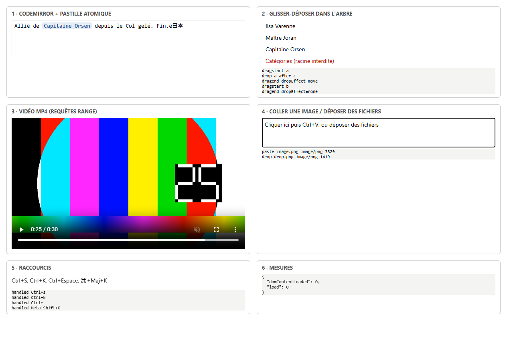

# Spike WebView (M0-08) — compte rendu

> Date : 14 octobre 2026 · Tâche : `tasks/M0-08-webview-spike.md` · Code jetable : `spikes/webview/`
> Objectif : lever au plus tôt le risque §A-10 (comportement des WebViews natifs utilisés par Photino) et, suite au constat de M0-07 (Photino.NET sans activité depuis janvier 2025), comparer Photino.NET au fork PhotinoX.

## 1. Résultats

| Point testé | Windows · Photino.NET 4.0.16 (WebView2) | Windows · PhotinoX 5.3.5 (WebView2) | Indication WebKit (Playwright 1.64, WebKit 27.2, Windows) | Linux · WebKitGTK 4.1 | macOS · WKWebView |
|---|---|---|---|---|---|
| 1. CodeMirror 6, pastille atomique : saisie, curseur, suppression, annulation | OK | OK | OK | non vérifié | non vérifié |
| 1. IME (touche morte `^`+`e`, composition japonaise) | OK (simulé CDP) | OK (simulé CDP) | non vérifiable | non vérifié | non vérifié |
| 2. Glisser-déposer HTML5 dans l'arbre, cible interdite refusée | OK · curseur « interdit » : à confirmer à l'œil | OK | OK, **écart** : `dragend.dropEffect` vaut `all` | non vérifié | non vérifié |
| 3. Vidéo MP4 H.264 : métadonnées, saut à 25 s (réponses `206`), lecture | OK | OK | OK (codec de ce portage, non représentatif) | non vérifié — **risque** : plugins GStreamer | non vérifié |
| 4. Coller une image depuis le presse-papiers de l'OS | OK (`image.png`, `image/png`) | OK | non testé (presse-papiers) | non vérifié | non vérifié |
| 4. Déposer un fichier depuis l'explorateur de l'OS | OK (simulé CDP) | OK | non testé | non vérifié | non vérifié |
| 5. `Ctrl+S`, `Ctrl+K`, `Ctrl+Espace`, `⌘+Maj+K` reçus par la page | OK (CDP **et** vraies frappes OS) | OK (CDP) | OK | non vérifié | non vérifié |
| 6. Démarrage (lancement → page prête) | 575–800 ms | 774 ms | — | non mesuré | non mesuré |
| 6. Mémoire (ensemble de travail) | hôte 70 Mo · total 444 Mo (7 processus) | hôte 71 Mo · total 449 Mo | — | non mesuré | non mesuré |

Légende : **OK** = vérifié automatiquement ; « simulé CDP » = événements injectés par le protocole DevTools dans le vrai WebView (pas par le clavier ou la souris de l'OS) ; « non vérifié » = aucune machine ni CI disponible pour ce test (voir §4).

## 2. Méthode

- **Hôte** : le vrai backend Erable (`ErableHost`, mode Desktop, `127.0.0.1`, port aléatoire) sert la page du spike ; la vidéo passe donc par le service de fichiers statiques réel (requêtes `Range`).
- **Windows** : `run-checks.mjs` lance l'hôte avec `WEBVIEW2_ADDITIONAL_BROWSER_ARGUMENTS=--remote-debugging-port=…`, pilote WebView2 en CDP (clavier, souris, glisser-déposer intercepté puis rejoué, presse-papiers rempli par `System.Windows.Forms` puis restauré), mesure la mémoire de l'hôte et de ses processus WebView2, ferme la fenêtre et vérifie la sortie du processus (OK dans tous les cas). L'option `--real-keys` envoie aussi de vraies frappes OS (`SendKeys`) après avoir vérifié que la fenêtre du spike est au premier plan.
- **Indication WebKit** : `webkit-checks.mjs` rejoue les contrôles portables dans le WebKit de Playwright. Même famille de moteur que WebKitGTK et WKWebView, mais pile média, presse-papiers et IME différents : ce n'est **pas** une validation de Linux ni de macOS.

## 3. Constats

1. **Aucun point bloquant sous Windows.** Les deux shells reposent sur le même WebView2 : comportement web identique, ce que confirment les mesures.
2. **Écart WebKit à retenir pour l'arbre (M1-10)** : `dragend.dropEffect` vaut `all` dans WebKit, contre `move` ou `none` dans Chromium. L'arbre doit décider du résultat d'un déplacement dans le gestionnaire `drop`, jamais dans `dragend`.
3. **Agent utilisateur** : Photino remplace l'agent utilisateur par `Photino WebView` (PhotinoX : `PhotinoX WebView`). Ne jamais détecter le navigateur par l'agent utilisateur ; détecter les fonctionnalités.
4. **Vidéo sous Linux** : WebKitGTK décode via GStreamer ; H.264 exige `gst-libav` (ou `gstreamer1.0-plugins-bad` selon la distribution), souvent absent par défaut. À vérifier en priorité et à documenter comme dépendance du paquet Linux (M5-03).
5. **WebKitGTK 4.1** : Photino.Native 4.0.22 et PhotinoX.Native 5.3.5 sont tous deux liés à `libwebkit2gtk-4.1.so.0` (Ubuntu 22.04+, Debian 12+, Fedora 36+).
6. **Mémoire** : ~445 Mo d'ensemble de travail au total, dont ~70 Mo pour l'hôte .NET ; le reste correspond aux processus WebView2 (navigateur, GPU, rendu, utilitaires), partagés en partie avec Edge. C'est l'ordre de grandeur attendu pour un WebView Chromium.
7. **API PhotinoX** : modèle d'application explicite (`PhotinoApplication.Run(window)`, `Dispatcher`, `ShutdownMode`) ; pour Erable, la migration se limite à `PhotinoShell.cs` (~10 lignes changent), comme le montre `spikes/webview/host-photinox/`. Cible .NET 10 native, binaires `win/linux/osx` x64 et arm64.

## 4. Non vérifié : Linux et macOS

Aucune machine Linux ou macOS n'est disponible, WSL n'est pas installé, et la branche n'est pas poussée (pas de CI à ce stade). Pour lever ces points :

- **Manuellement**, sur une machine de chaque OS : `pnpm -C spikes/webview/web install && pnpm -C spikes/webview/web media && pnpm -C spikes/webview/web build`, puis `dotnet run --project spikes/webview/host -- "$PWD/spikes/webview/web/dist"` et dérouler la page à la main (saisie avec IME réel, glisser-déposer avec curseur interdit visible, vidéo et saut, `Ctrl+V` d'une capture d'écran, dépôt d'un fichier depuis le gestionnaire de fichiers, raccourcis).
- **En CI** (M0-10 / M0-11) : le mode `--self-test` de M0-11 rejouera un sous-ensemble sous `xvfb` (Linux) et sur macOS.

## 5. Recommandation

**Garder une architecture Photino (pas de bascule vers Electron)** : aucun point bloquant sous Windows, et l'indication WebKit est bonne sur l'éditeur, le glisser-déposer et les raccourcis.

**Basculer de Photino.NET vers PhotinoX** dès qu'un premier test Linux ou macOS l'a confirmé (ou plus tôt si un bug amont bloque) :

- Photino.NET n'a plus de commit de code depuis janvier 2025 ; aucun correctif à attendre pour WebKitGTK ou WKWebView, qui sont précisément nos points à risque ;
- PhotinoX est maintenu, cible .NET 10, se comporte à l'identique sous Windows, et le coût de migration est d'environ 10 lignes dans `PhotinoShell.cs` ;
- risque résiduel : un seul mainteneur (Apache-2.0, forkable). Electron reste le repli de Q6.

Décision à prendre par l'utilisateur ; une fois prise, mettre à jour Q6 dans `docs/architecture.md`.
